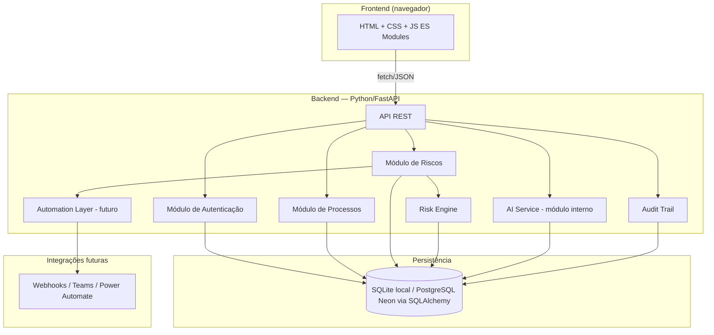
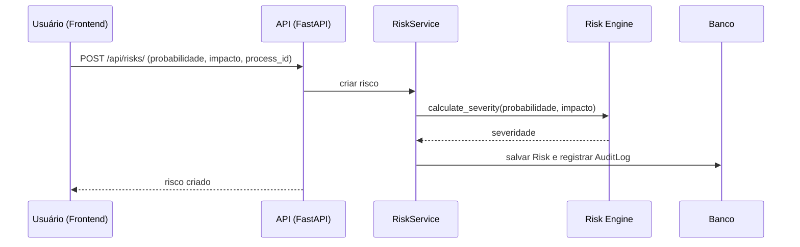
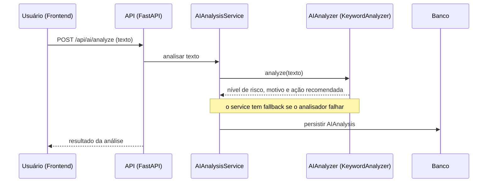

# NEXUS — Arquitetura Técnica

> Documento vivo. Atualizado a cada fase do projeto conforme decisões técnicas são tomadas.

## 1. Contexto e restrições de ambiente

O ambiente de desenvolvimento (computador corporativo) tem as seguintes restrições confirmadas via diagnóstico:

- Node.js/npm: indisponíveis, e a execução de binários não autorizados é bloqueada por política (AppLocker/WDAC ou similar).
- Docker: indisponível.
- PostgreSQL: indisponível.
- Python 3.13 + pip: **disponíveis e funcionais**.
- Git: disponível.

Essas restrições definem a stack real da Fase 1 em diante. A arquitetura foi desenhada para funcionar **hoje**, nesse ambiente, e para migrar sem retrabalho caso restrições futuras sejam removidas (ex: banco trocado para PostgreSQL, ou frontend portado para React/Vite em outro ambiente).

## 2. Visão geral do sistema



## 3. Decisões arquiteturais

Cada decisão segue o formato **Problema → Alternativas → Decisão → Justificativa**, conforme solicitado.

### 3.1 Framework de backend

- **Problema:** precisamos de um backend robusto, tipado o quanto possível, com boa documentação de API, rodando em um ambiente sem Node.js.
- **Alternativas:** NestJS (Node), Express (Node), FastAPI (Python), Django (Python), Flask (Python).
- **Decisão:** FastAPI.
- **Justificativa:** é a única opção viável dado que Python é o único runtime confirmado. Entre as opções Python, FastAPI oferece tipagem via Pydantic (equivalente ao TypeScript em termos de validação e autocomplete), geração automática de documentação OpenAPI/Swagger, alta performance (async nativo) e é o padrão de mercado para APIs de IA/dados em Python — o que reforça a narrativa de portfólio ("AI Service" e "Backend" na mesma linguagem, mas em módulos desacoplados).

### 3.2 Banco de dados e ORM

- **Problema:** o banco precisa poder trocar de SQLite (desenvolvimento local) para PostgreSQL (produção) sem reescrever a aplicação.
- **Alternativas:** acesso direto via `sqlite3`/`psycopg2` (sem ORM), Prisma (não disponível sem Node), SQLAlchemy, Tortoise ORM.
- **Decisão:** SQLAlchemy (com Alembic para migrations).
- **Justificativa:** SQLAlchemy é database-agnostic — o código de acesso a dados (models, queries) não muda ao trocar o dialeto do banco; só a *connection string* muda. Alembic gerencia migrations de forma versionada, o que é essencial para simular um fluxo real de evolução de schema em produção. É o "Prisma do mundo Python" em termos de maturidade e adoção de mercado.

### 3.3 Frontend sem build step

- **Problema:** o frontend deveria usar React + TypeScript + Vite, mas isso depende de Node.js, indisponível e bloqueado no ambiente atual.
- **Alternativas:** (a) adiar todo o frontend até ter outro ambiente; (b) frontend "buildless" com HTML/CSS/JS moderno; (c) framework server-side em Python (ex: Jinja2 + HTMX).
- **Decisão:** (b) — HTML/CSS/JS puro com ES Modules, sem framework e sem build, consumindo a API REST via `fetch`. Fontes IBM Plex, ícones SVG inline e estilos em um único `main.css`.
- **Justificativa:** mantém a separação clara frontend/backend (a API não sabe nada sobre como os dados são renderizados, o que facilita portar para React depois, se houver acesso a Node em outro ambiente). Evita bloquear o progresso do projeto e entrega uma UI com aparência de produto SaaS sem ferramenta de build.
- **Nota de roadmap:** o contrato de API (JSON) será desenhado de forma que uma futura migração para React consuma exatamente os mesmos endpoints — nenhuma mudança de backend seria necessária.

### 3.4 AI Service: módulo interno vs. serviço separado

- **Problema:** o design original pedia um serviço de IA totalmente separado (outro processo/porta). Isso normalmente se beneficia de Docker Compose para orquestração, que está indisponível.
- **Alternativas:** (a) processo Python separado rodando em outra porta, orquestrado manualmente; (b) módulo interno do mesmo FastAPI, com fronteira de código isolada (pasta própria, interface abstrata).
- **Decisão:** (b) para a fase atual, com a interface desenhada para permitir extração para (a) sem reescrever a lógica interna.
- **Justificativa:** sem Docker, orquestrar dois processos manualmente (dois terminais, duas portas, CORS entre eles) adiciona complexidade operacional sem benefício real nesta fase. O importante arquiteturalmente é o **desacoplamento lógico** (a camada de negócio não chama diretamente uma API de IA específica, mas uma interface `AIAnalyzer`), não o desacoplamento físico. Isso é o mesmo princípio de "Dependency Inversion" que se aplicaria mesmo com serviços separados.

### 3.5 Autenticação

- **Problema:** precisamos de autenticação segura sem depender de serviços externos (ex: Auth0) para manter o projeto autocontido.
- **Alternativas:** sessão baseada em cookie, JWT, OAuth2 com provedor externo.
- **Decisão:** JWT (HS256, access token de 30 minutos, sem refresh token), com senhas hasheadas via `passlib[bcrypt]` (`bcrypt==4.0.1` fixado).
- **Justificativa:** JWT é stateless (não exige tabela de sessões ativas, simplificando o SQLite), é o padrão esperado em entrevistas técnicas para esse tipo de sistema, e se integra bem com um frontend desacoplado (seja vanilla JS agora ou React depois).

### 3.6 Estrutura de repositório

- **Problema:** organizar backend, AI service (módulo) e frontend de forma que fique clara a separação de responsabilidades, mesmo compartilhando o mesmo processo Python por ora.
- **Alternativas:** monorepo com pastas separadas; múltiplos repositórios Git.
- **Decisão:** monorepo.
- **Justificativa:** para um projeto de portfólio, um monorepo facilita a avaliação por recrutadores/entrevistadores (tudo em um só lugar, com README central) e simplifica o versionamento nesta fase solo do projeto.

## 4. Estrutura de pastas (desenho original da Fase 1)

> O desenho abaixo é o planejamento original. A estrutura real e atual está na seção "Estrutura do projeto" do `README.md` (por exemplo, o backend ganhou a entidade Ações e o frontend tem páginas de detalhe).

```
nexus/
├── backend/
│   ├── app/
│   │   ├── main.py                 # entrypoint FastAPI
│   │   ├── core/
│   │   │   ├── config.py           # variáveis de ambiente, settings
│   │   │   └── security.py         # JWT, hashing
│   │   ├── db/
│   │   │   ├── base.py             # engine, sessionmaker (SQLAlchemy)
│   │   │   └── session.py
│   │   ├── models/                 # entidades SQLAlchemy
│   │   │   ├── user.py
│   │   │   ├── process.py
│   │   │   ├── risk.py
│   │   │   ├── audit_log.py
│   │   │   └── ...
│   │   ├── schemas/                # Pydantic (DTOs de entrada/saída)
│   │   ├── repositories/           # acesso a dados (query layer)
│   │   ├── services/               # regras de negócio
│   │   │   ├── risk_engine.py
│   │   │   ├── ai_analyzer/        # módulo de IA (interface + implementação)
│   │   │   └── automation.py
│   │   ├── api/
│   │   │   └── v1/
│   │   │       ├── auth.py
│   │   │       ├── processes.py
│   │   │       ├── risks.py
│   │   │       ├── dashboard.py
│   │   │       ├── audit.py
│   │   │       └── ai.py
│   │   └── middlewares/
│   ├── tests/
│   ├── alembic/                    # migrations versionadas
│   ├── requirements.txt
│   └── .env.example
├── frontend/
│   ├── index.html
│   ├── src/
│   │   ├── main.js
│   │   ├── api/                    # client fetch da API
│   │   ├── pages/
│   │   ├── components/             # Web Components reutilizáveis
│   │   └── styles/
│   └── assets/
├── docs/
│   ├── ARCHITECTURE.md             # este documento
│   └── diagrams/
└── README.md
```

## 5. Fluxos de dados principais

### 5.1 Criação de um risco



A severidade nunca é informada pelo cliente: é sempre calculada pela matriz 4×4 do Risk Engine. Nível inválido gera `KeyError` de propósito.

### 5.2 Análise de risco por texto (IA)



A análise é um endpoint independente: criar um risco não a dispara. Toda análise é persistida na tabela `ai_analyses`. A automação por webhooks (Teams, Power Automate) continua no roadmap e não faz parte do fluxo atual.

### 5.3 Exclusão de risco e de processo

As regras ficam no service; o router apenas traduz o resultado em HTTP.

- **Risco:** `RiskService.delete_risk` apaga primeiro as ações vinculadas, registrando cada uma na auditoria (`audit.log_delete`), e só então exclui o risco. A resposta é 204.
- **Processo:** `ProcessService.delete_process` levanta `ValueError` se houver riscos vinculados; o router `processes.py` converte o erro em **HTTP 409** com a mensagem "Processo possui riscos vinculados. Exclua os riscos antes de excluir o processo.". Nada é apagado em cascata.

Os dois comportamentos possuem teste automatizado (`test_delete_risk_with_actions_deletes_actions_too` e `test_delete_process_with_risks_returns_409`).

## 6. Banco de dados e migração SQLite → PostgreSQL

A migração está concluída. O desenvolvimento local usa SQLite (`sqlite:///./nexus.db`) e a produção usa PostgreSQL no Neon (região São Paulo). A troca se resume à variável `DATABASE_URL`, que em PostgreSQL usa o prefixo `postgresql+psycopg://`.

1. Todo o acesso a dados passa pelo SQLAlchemy, sem SQL cru específico de dialeto.
2. O schema é gerenciado pelo Alembic (6 migrations), aplicado com `alembic upgrade head` em ambos os bancos.
3. Não houve migração de dados: o banco de produção é populado pela própria API, com `backend/seed_demo.py` (dados sintéticos), de modo que a severidade vem do Risk Engine e a auditoria é registrada.
4. `pool_pre_ping` e `pool_recycle=280` na sessão tratam conexões que o Neon derruba ao suspender o compute.
5. Os testes usam um SQLite isolado (`test.db`), independente do `.env`.

## 7. Hospedagem e operação

| Componente | Serviço |
| ---------- | ------- |
| Backend (FastAPI) | Render Web Service, plano Free, Root Directory `backend` |
| Frontend (estático, sem build) | Render Static Site, Root Directory `frontend` |
| Banco de dados | Neon (PostgreSQL), conexão direta |

- O frontend escolhe a URL da API pelo hostname (`src/api/client.js`): `localhost` e `127.0.0.1` usam o backend local, qualquer outro host usa o backend publicado.
- O CORS é configurável pela variável `CORS_ORIGINS` (lista separada por vírgulas, sem espaços e sem barra final).
- Segredos (`SECRET_KEY`, `DATABASE_URL`) existem apenas como variáveis de ambiente e nunca são versionados.
- O CI (GitHub Actions) roda os 43 testes a cada push. O deploy no Render é automático a cada push na `main`.
- **Cold start:** no plano Free o backend hiberna após cerca de 15 minutos sem acesso, e a primeira requisição leva de 30 a 60 segundos.

## 8. Riscos e pontos de atenção conhecidos

- **Concorrência no SQLite:** limitação aceita, pois o SQLite é usado só no desenvolvimento local.
- **Frontend sem build:** exige disciplina manual na organização dos módulos JS. Mitigado com ES Modules nativos; uma migração para React/Vite só fará sentido se o ambiente permitir.
- **IA por palavras-chave:** o `KeywordAnalyzer` é uma heurística atrás da interface `AIAnalyzer`, então pode ser trocado por um modelo real sem mudar os services. Roda no mesmo processo da API, uma adaptação de ambiente e não uma limitação de design.
- **Cadastro público:** `POST /api/users/` não exige autenticação. É uma escolha consciente para o portfólio e seria restrito em um cenário real.
- **Autorização binária:** o campo `role` existe, mas não é verificado.
- **JWT em `localStorage`:** o logout é apenas no cliente (trade-off do modelo stateless).
- **Docker:** `Dockerfile` e `docker-compose` estão escritos, mas nunca foram testados, porque o ambiente de desenvolvimento não tem Docker.
- **Cold start** do plano gratuito do Render (ver seção 7).

## 9. Próximos passos

O roadmap vigente está no `README.md`. Pendências de acabamento: testes automatizados para Ações e Auditoria, controle de acesso por papéis, página própria de Ações e exportação de relatórios.
